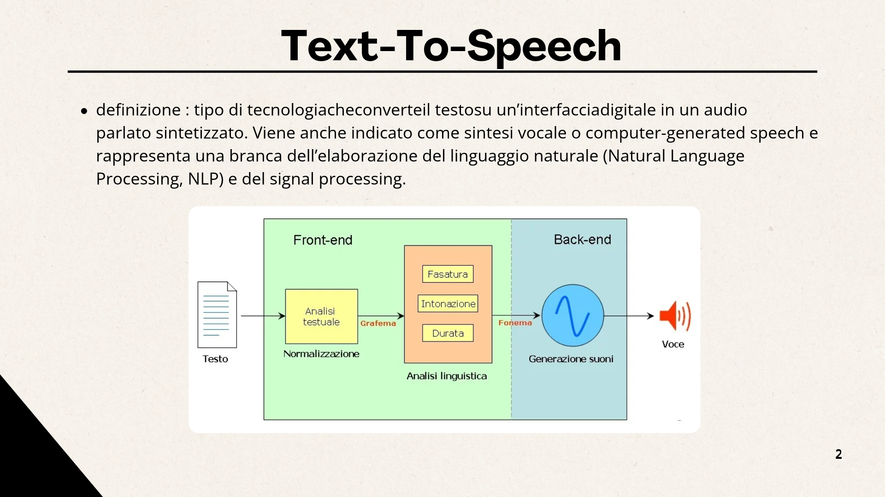

# Fish-Speech TTS Application

A Streamlit-based application for advanced text-to-speech (TTS) synthesis, powered by the Fish-Speech framework and the OpenAudio S1 Mini model.

The application provides an intuitive interface for generating high-quality speech, supporting voice cloning from reference audio and advanced control over generation parameters.


## Academic Context

This application was developed as the experimental project for my Bachelor's thesis in Computer Engineering.

The project focused on exploring modern neural text-to-speech technologies, with particular emphasis on speech synthesis and voice cloning using the Fish-Speech framework and the OpenAudio S1 Mini model.

## Features

- **High-quality speech synthesis** powered by OpenAudio S1 Mini
- **User-friendly interface** built with Streamlit
- **Voice cloning** using reference audio
- **Advanced generation settings** for fine-grained control over speech synthesis
- **Audio playback and download** of generated speech
- **Multiple audio formats supported** (WAV, MP3, OGG, FLAC)

## Requirements

- Python 3.12
- GPU (recommended) or CPU (with limited performance)
- At least 8 GB of RAM
- At least 4 GB of free disk space for the models

## Installation

### 1. Clone this repository

```bash
git clone https://github.com/your-username/fish-speech-tts-app.git
cd fish-speech-tts-app
```

### 2. Clone the Fish-Speech repository

```bash
git clone https://github.com/fishaudio/fish-speech.git
cd fish-speech
```

### 3. Set up the virtual environment

First, install the system dependencies required for audio processing and synthesis:

```bash
sudo apt install portaudio19-dev libsox-dev ffmpeg
```

Then, create and activate the Conda environment and install Fish-Speech:

```bash
conda create -n fish-speech python=3.12
conda activate fish-speech

pip install -e .
```

For the latest installation instructions and any additional requirements, refer to the official Fish-Speech documentation:

[Fish-Speech Installation Guide](https://github.com/fishaudio/fish-speech/blob/main/docs/en/install.md)

### 4. Download the model

Download the OpenAudio S1 Mini model required for speech synthesis:

```bash
huggingface-cli download fishaudio/openaudio-s1-mini --local-dir checkpoints/openaudio-s1-mini
```

**Note:** A Hugging Face account and an access token are required to download the model. You can create an access token from your Hugging Face account settings.

You must also accept the OpenAudio S1 Mini model's terms of use before downloading it.

For further information, refer to the official inference documentation:

[Fish-Speech Inference Guide](https://github.com/fishaudio/fish-speech/blob/main/docs/en/inference.md)

### 5. Install the application dependencies

From the root directory of the project, navigate to the Streamlit application folder:

```bash
cd ../streamlit_app
pip install -r requirements.txt
```

### 6. Run the application

Start the Streamlit application:

```bash
streamlit run app.py
```

The application will be available at:

`http://localhost:8501`

## Usage

- **Text Input:** Enter the text you want to convert into speech.
- **Reference Audio:** Optionally upload an audio file to enable voice cloning.
- **Generation Parameters:** Adjust the settings in the sidebar to customize the speech synthesis process.
- **Generate Audio:** Click the "Generate Audio" button to start speech synthesis.
- **Audio Playback:** Listen to the generated audio directly within the application.
- **Download:** Download the generated audio file.

### Configurable Parameters

| Parameter | Range | Description |
|---|---|---|
| **Temperature** | 0.1–1.0 | Controls the randomness of the generation process. |
| **Top-p** | 0.1–1.0 | Controls token sampling by limiting the selection to the most probable tokens. |
| **Repetition Penalty** | 1.0–2.0 | Reduces repetitive outputs during generation. |
| **Max Tokens** | 256–4096 | Sets the maximum number of tokens generated. |
| **Chunk Length** | 100–500 ms | Controls the processing chunk size. |

---

**Technologies:** Python · PyTorch · Fish-Speech · OpenAudio S1 Mini · Streamlit

## Presentation

You can view the project presentation below or access the complete slide deck in PDF format.

[**View the full presentation (PDF)**](docs/TTS_Thesis.pdf)


